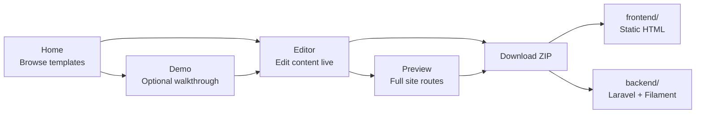
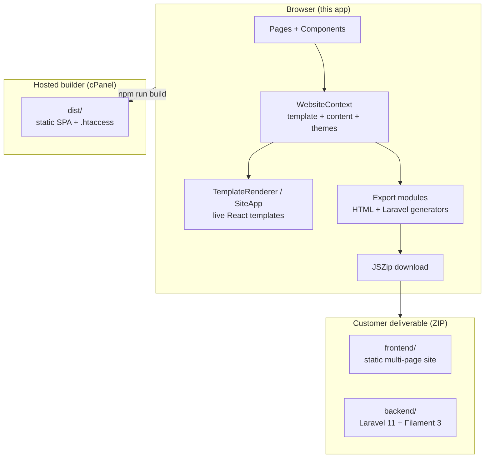
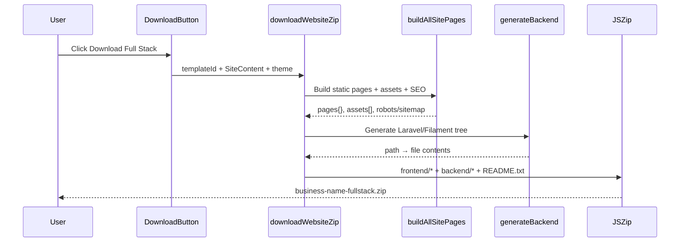
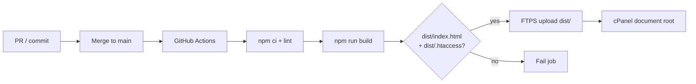

# WebBuilder

**Pick a template → customize content → preview → download a full-stack site.**

WebBuilder is a browser-based website builder for business and hospitality sites. Teams choose a industry template, edit copy and media in a live editor, preview the result, then export a ZIP with:

| Package | What you get |
|---------|----------------|
| **`frontend/`** | Multi-page static HTML (no server required) |
| **`backend/`** | Laravel 11 + Filament 3 admin, prefilled content, contact forms, optional booking |

This repository is the **builder app itself** (React + Vite). It is not the generated customer website — that is produced at download time in the browser.

---

## Table of contents

- [Who is this for?](#who-is-this-for)
- [How it works (user journey)](#how-it-works-user-journey)
- [System architecture](#system-architecture)
- [App routes](#app-routes)
- [Export pipeline](#export-pipeline)
- [Repository layout](#repository-layout)
- [Tech stack](#tech-stack)
- [Local development](#local-development)
- [Deploy (cPanel + GitHub Actions)](#deploy-cpanel--github-actions)

---

## Who is this for?

| Audience | Why open this repo |
|----------|--------------------|
| **Product / design** | Understand templates, editor UX, preview flows |
| **Frontend** | React SPA, templates, forms, localStorage state |
| **Backend / platform** | How Laravel + Filament exports are generated |
| **DevOps** | Build, SPA hosting on Apache, CI deploy to cPanel |
| **Support / CS** | What customers download and how static vs Laravel differ |

---

## How it works (user journey)



1. **Home** (`/`) — filter templates by category (business, food, hospitality, health, …).
2. **Demo / Editor** — open a template; left panel edits content, right panel shows a live iframe-style render.
3. **Preview / Site** — navigate the multi-page site (about, services, rooms, booking, blog, …) as a real React app.
4. **Download** — browser builds HTML + PHP files with [JSZip](https://stuk.github.io/jszip/) and downloads `{business-name}-fullstack.zip`.

Drafts are auto-saved in **localStorage** while editing (see `src/utils/storage.ts`).

---

## System architecture



Important separation:

- **WebBuilder SPA** = the product teams deploy (this repo → `dist/` on cPanel).
- **Exported site** = what end users put on *their* hosting after download. Generation runs entirely client-side; no API server is required for export.

---

## App routes

| Path | Page | Role |
|------|------|------|
| `/` | `HomePage` | Template gallery + category filter |
| `/demo/:templateId/*` | `TemplateDemoPage` | Demo mode for a template |
| `/editor/:templateId/*` | `EditorPage` | Split editor + live preview |
| `/preview/:templateId/*` | `PreviewPage` | Full preview shell |
| `/site/:templateId/*` | `SiteViewPage` | Chromeless multi-page site (also fullscreen) |

Nested site pages (inside preview/site) are handled by `src/templates/SiteApp.tsx`:

```
/site/:id          → Home
/site/:id/about
/site/:id/services
/site/:id/portfolio | gallery | blog | news | contact
/site/:id/rooms | book | book/confirm/:code   (hospitality)
```

Because routing is client-side (`BrowserRouter`), production Apache hosting needs `public/.htaccess` so deep links like `/preview/hotel` do not return **404** on refresh.

---

## Export pipeline



| Export side | Modules (entry points) | Output |
|-------------|------------------------|--------|
| Static | `export/buildSitePages.ts`, `generateHtml.ts`, section/nav/SEO helpers | `frontend/*.html`, assets, optional `robots.txt` / `sitemap.xml` |
| Dynamic | `export/backend/generateBackend.ts`, Blade, Filament, booking | `backend/` ready for Composer + deploy |

Hospitality templates can include **room types**, **inventory**, and **booking** flows that map into both the live React preview and the Laravel export.

---

## Repository layout

```text
web-builder-exp/
├── .github/workflows/deploy.yml   # CI: lint, build, FTPS → cPanel
├── docs/DEPLOY.md                 # Secrets + hosting setup
├── public/
│   ├── .htaccess                  # SPA rewrite for Apache (preview 404 fix)
│   └── favicon.svg
├── src/
│   ├── App.tsx                    # Router shell
│   ├── pages/                     # Home, Editor, Preview, Demo, Site
│   ├── components/                # Forms, pickers, cards, download
│   ├── context/WebsiteContext.tsx # Global editor state + persistence
│   ├── catalog/                   # Template JSON manifests + loader
│   ├── data/                      # Catalog-backed lookups, nav, form helpers
│   ├── templates/                 # Per-industry React shells + SiteApp
│   ├── export/                    # Static HTML + Laravel generators
│   ├── types/                     # SiteContent, TemplateId, visibility, …
│   └── utils/                     # storage, links, SEO helpers, slugs
├── package.json
└── vite.config.ts
```

### Where to change what

| Goal | Start here |
|------|------------|
| Add a catalog template | Add `src/catalog/manifests/<id>.json` (design). Site edits export as `site.json` in the ZIP. |
| Editor form fields | `src/components/ContentForm.tsx`, list helpers in `src/data/listDefaults.ts` |
| Colors / layout variants | `src/data/colorSchemes.ts`, `src/data/layoutVariants.ts` |
| Live multi-page site | `src/templates/SiteApp.tsx`, section layouts |
| Static HTML export | `src/export/buildSitePages.ts`, `sectionExport.ts`, … |
| Laravel / Filament export | `src/export/backend/*` |
| SPA hosting / 404s | `public/.htaccess` |
| Production deploy | `.github/workflows/deploy.yml`, `docs/DEPLOY.md` |

---

## Tech stack

| Layer | Choice |
|-------|--------|
| UI | React 19, React Router 7 |
| Build | Vite 8, TypeScript |
| Styles | Tailwind CSS 4 (`@tailwindcss/vite`) |
| Lint | Oxlint |
| ZIP export | JSZip |
| Hosting target (builder) | Static files on Apache (cPanel) |
| Export backend | Laravel 11 + Filament 3 (generated, not runtime of this repo) |

---

## Local development

**Requirements:** Node.js 22+ (CI uses 22), npm.

```bash
# Install
npm ci

# Dev server (HMR)
npm run dev

# Typecheck + production build → dist/
npm run build

# Lint
npm run lint

# Preview production build locally
npm run preview
```

Open the URL Vite prints (usually `http://localhost:5173`).

### Local SPA deep links

`vite preview` and the dev server handle history fallback. On Apache/cPanel, that role is filled by `public/.htaccess` (copied into `dist/` on build).

---

## Deploy (cPanel + GitHub Actions)




