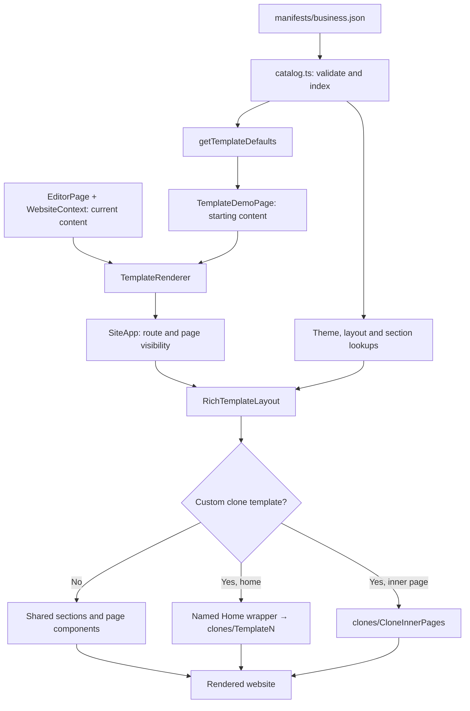
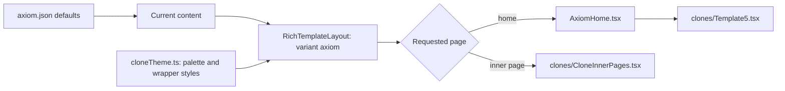
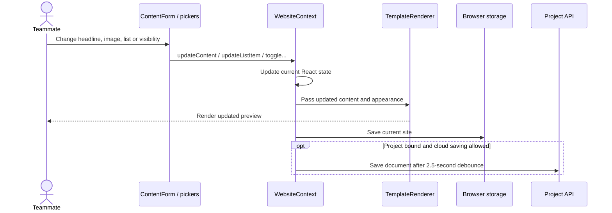
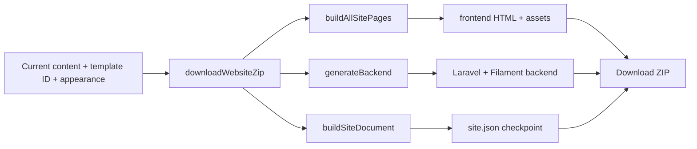

# CMS template code guide — business sites and custom homepages

This guide covers the non-hotel templates: business, food, creative, medical, finance and other CMS-backed websites. It follows `business` for the shared renderer, then shows the custom homepage path used by Axiom and five related templates. For hotel rooms and booking, see [the hotel template guide](hotel-template-guide.md).

## Find a template by name or ID

The URL `/demo/business` points to [business.json](../src/catalog/manifests/business.json). Search manifest metadata if you only know a gallery name:

```bash
# From web-builder-exp/
rg -n '"name"|"id"' src/catalog/manifests
rg -n '"name"' src/catalog/manifests/axiom.json
```

The gallery is [TemplateLibraryPage.tsx](../src/pages/TemplateLibraryPage.tsx), with components such as `TemplateGallery.tsx` and `TemplateCard.tsx`. Thumbnail lookup is in [thumbnails.ts](../src/catalog/thumbnails.ts), reading `src/assets/hero-sections/<id>.png`.

## The shared render flow



### 1. The manifest supplies content and design

[TemplateManifest](../src/catalog/types.ts) defines what a JSON template can contain. The important fields are:

| Manifest area | Responsibility |
|---|---|
| `id`, `name`, `description`, `category` | Catalog identity and gallery metadata |
| `features` | Declared template capabilities |
| `defaults` | Starting text, images, lists and content visibility |
| `theme`, `colorSchemes` | CSS class tokens and palette overrides |
| `homeSections` | Starting sequence of homepage sections |
| `pageLayouts`, `sectionVariants`, `navShell` | Select supported page, section and navigation designs |
| `editorPages`, `editorSections` | Optional overrides for editor controls |
| `blocks` | Per-block design configuration |

The current `content.pageVisibility` governs route eligibility and teaser visibility. Top-level manifest configuration and editable content have distinct roles; routes themselves are declared in TypeScript.

### 2. A URL selects a page

[App.tsx](../src/App.tsx) routes `/demo/:templateId/*` to the demo and `/editor/:templateId/*` to the protected editor. The demo loads defaults; the editor supplies current state. Both use [TemplateRenderer.tsx](../src/templates/TemplateRenderer.tsx), which forwards props to [SiteApp.tsx](../src/templates/SiteApp.tsx).

| Example URL | Page passed to the layout |
|---|---|
| `/demo/business` | `home` |
| `/demo/business/about` | `about` |
| `/demo/business/services` | `services` |
| `/demo/business/blog` | `blog` |
| `/demo/business/blog/<slug>` | `blog-post` |
| `/demo/business/contact` | `contact` |

`SitePage` calls `canLinkToPage()` to reject disabled/ineligible pages. It then renders `RichTemplateLayout` with `variant="business"`, the selected `page`, current content and appearance settings.

### 3. Shared components draw the page

[RichTemplateLayout.tsx](../src/templates/RichTemplateLayout.tsx) aliases content to `c`, resolves theme classes as `t`, and chooses a section order. Homepage order comes from `homeSectionsFor()`; inner pages use `PAGE_SECTIONS`.

```tsx
// Examples from the section map; props abbreviated for readability.
hero: <HeroSection ... />,
services: <ServicesSection ... />,
'blog-page': <BlogListPage ... />,
'blog-post-page': <BlogPostPage ... />,
```

`order.map(...)` turns that section sequence into the rendered page. Visibility can return null sections. The homepage helper also inserts optional `steps`, `pricing`, `team` and `cta` sections if missing, so the raw manifest list is only part of the final decision.

A file named [BusinessTemplate.tsx](../src/templates/BusinessTemplate.tsx) exists, but it is a thin wrapper around `RichTemplateLayout`. Follow the active route/renderer chain to reach the markup you need.

| Visible area | Implementation |
|---|---|
| Shared hero, stats, services, about, footer | Functions inside `RichTemplateLayout.tsx` |
| Navigation designs | [navLayouts.tsx](../src/templates/navLayouts.tsx) |
| Contact, FAQ and explore designs | [sectionLayouts.tsx](../src/templates/sectionLayouts.tsx) |
| Blog lists/posts, news, gallery, portfolio and page teasers | [PageLayoutSections.tsx](../src/templates/PageLayoutSections.tsx) |
| Page layout selections | [pageLayouts.ts](../src/templates/pageLayouts.ts) |
| Theme and palette resolution | [getTheme.ts](../src/templates/getTheme.ts), `customPaletteTheme.ts` |

For example, a heading in the shared hero uses `c.tagline` as its text and `t.heroTitle` as its CSS classes. Change a manifest default for future starting content; change state through the editor for a customer's content; change JSX for HTML structure.

## The six custom homepage templates

These templates branch away from the shared section assembly. In `RichTemplateLayout.tsx`, search `customHome` and `isCloneTemplate`.

| ID | Definition | Wrapper in `src/templates/` | Main homepage markup |
|---|---|---|---|
| `taxfighters` | [taxfighters.json](../src/catalog/manifests/taxfighters.json) | `TaxFightersHome.tsx` | [Template1.tsx](../src/templates/clones/Template1.tsx) |
| `aureum` | [aureum.json](../src/catalog/manifests/aureum.json) | `AureumHome.tsx` | [Template2.tsx](../src/templates/clones/Template2.tsx) |
| `flux` | [flux.json](../src/catalog/manifests/flux.json) | `FluxHome.tsx` | [Template3.tsx](../src/templates/clones/Template3.tsx) |
| `cpa` | [cpa.json](../src/catalog/manifests/cpa.json) | `CpaHome.tsx` | [Template4.tsx](../src/templates/clones/Template4.tsx) |
| `axiom` | [axiom.json](../src/catalog/manifests/axiom.json) | `AxiomHome.tsx` | [Template5.tsx](../src/templates/clones/Template5.tsx) |
| `helix` | [helix.json](../src/catalog/manifests/helix.json) | `HelixHome.tsx` | [Template6.tsx](../src/templates/clones/Template6.tsx) |

### Follow Axiom as an example



[AxiomHome.tsx](../src/templates/AxiomHome.tsx) forwards `c` and `basePath` to `Template5`. That is where to read Axiom's homepage JSX. Shared clone chrome and inner pages are in [CloneChrome.tsx](../src/templates/clones/CloneChrome.tsx) and [CloneInnerPages.tsx](../src/templates/clones/CloneInnerPages.tsx). [cloneTheme.ts](../src/templates/cloneTheme.ts) identifies this template family and resolves its palette.

For these custom homepages, read the selected `TemplateN.tsx` before changing `homeSections`: the custom branch returns its own component instead of the ordinary `order.map(...)` output. The actual component determines which content and design settings it consumes.

## Edit CMS content: practical examples

| You want to change… | One customer's site | Starting template / implementation |
|---|---|---|
| Headline or business name | Corresponding editor field | Manifest `defaults.tagline` / `defaults.businessName` |
| Service cards | Services list controls | Manifest default services; `ServicesSection` / selected custom component |
| Blog article title/body | Blog list controls | Default blog data; `BlogListPage` / `BlogPostPage` or clone inner-page implementation |
| News or gallery entries | Relevant list/image controls | Default content lists and selected page renderer |
| Contact details and images | Form/image controls | Manifest defaults; contact section renderer |
| Available optional pages/sections | Visibility controls offered by editor | `editorProfile.ts`, manifest configuration and rendering conditions |
| Axiom homepage structure | Requires a code change | `clones/Template5.tsx`, then matching export implementation |

`ContentForm.tsx` connects inputs to context actions. `data/listDefaults.ts` defines newly added list items, while `data/editorProfile.ts` determines available page/section controls. For a custom homepage, confirm that its JSX actually reads the field you expose in the editor.

For exported custom pages, inspect [cloneHomeExport.ts](../src/export/cloneHomeExport.ts); for ordinary pages inspect [homePageExport.ts](../src/export/homePageExport.ts), [buildSitePages.ts](../src/export/buildSitePages.ts) and [sectionExport.ts](../src/export/sectionExport.ts). Generated CMS/admin behavior is under `src/export/backend/`.

## Codebase map

Paths in this guide are relative to `web-builder-exp/`; links open the source files. The sibling `buildoura-api/` and `buildoura-admin/` directories are separate applications.

```text
web-builder-exp/
├── src/
│   ├── App.tsx                       Application routes and providers
│   ├── pages/                        Gallery, demo, editor, preview, account screens
│   ├── catalog/
│   │   ├── manifests/<id>.json        Template definitions and starting content
│   │   ├── catalog.ts                Discover, validate and look up manifests
│   │   ├── types.ts                  Manifest field definitions
│   │   └── validate.ts               Manifest validation rules
│   ├── data/                         Defaults, navigation, editor profiles and presets
│   ├── components/                   Content forms, images and appearance controls
│   ├── context/WebsiteContext.tsx    Current site state and persistence
│   ├── templates/                    React pages and shared rendering components
│   ├── siteDocument/                 Saved site document schema, validation and I/O
│   ├── export/                       Static HTML and generated Laravel backend
│   ├── api/                          Builder API clients, including project drafts
│   ├── auth/                         Login state and protected routes
│   ├── types/                        SiteContent and related TypeScript types
│   ├── assets/hero-sections/          Gallery thumbnails, named <id>.png
│   └── utils/                        Storage, migrations, links and image helpers
├── public/                           Public assets and Apache SPA routing rules
└── docs/                             These navigation guides
```

## Three kinds of data to keep separate

| Layer | Example | When you change it |
|---|---|---|
| Template definition | `theme`, `homeSections`, `pageLayouts`, `defaults` in a manifest | Change the starting design/content offered by the builder |
| Current site content | `WebsiteContext.content`, with text, lists and visibility | Edit one customer's site in the builder |
| Saved/exported site | Project document, `site.json`, generated HTML and Laravel files | Restore a project or deploy its generated website |

The catalog loader in [catalog.ts](../src/catalog/catalog.ts) uses `import.meta.glob('./manifests/*.json', { eager: true })`. It validates bundled manifests and indexes them by `id`. Invalid bundled manifests produce an error. Imported manifests can also be stored in the browser and override a bundled ID; inspect imported templates if the browser differs from the source JSON.

[defaults.ts](../src/data/defaults.ts) loads `manifest.defaults` through `migrateContent()`. This fills/normalizes content for the current schema. A manifest is therefore the starting point, while rendered content may also reflect migration, selected branding or an existing saved project.

## How editing a site's content works



[ContentForm.tsx](../src/components/ContentForm.tsx) reads `useWebsite()` and calls actions provided by [WebsiteContext.tsx](../src/context/WebsiteContext.tsx). For example, the business-name control uses this pattern:

```tsx
onChange={(v) => updateContent({ businessName: v })}
```

`updateContent` merges the supplied fields into existing content:

```tsx
setContent((prev) => ({ ...prev, ...updates }))
```

| Kind of edit | Action / source |
|---|---|
| Headline, business name, contact details | `updateContent({ field: value })` |
| An existing list item | `updateListItem(list, index, field, value)` |
| Add/remove a list item | `addListItem(list)` / `removeListItem(list)`; see `data/listDefaults.ts` |
| Enable/disable a page | `togglePageVisibility(page)` |
| Enable/disable an optional section | `toggleSectionVisibility(section)` |
| Color scheme or layout preset | `setColorScheme()` / `setLayoutVariant()` |
| Restore an imported or saved document | `restoreSite()` / `bindProject()` |

These actions edit the current site in memory and persistence; they do not rewrite a source manifest. Local saving uses [storage.ts](../src/utils/storage.ts). Cloud saving requires a bound project and `canCloudSave`; `persistNow()` performs an explicit project save. Project data can replace defaults when opening an existing project.

### Edit starting content as a developer

1. Open `src/catalog/manifests/<id>.json`.
2. Change fields under `defaults` for initial copy, images or list data.
3. Use `/demo/<id>` to check the starting content directly.
4. Use the editor to check controls and the current project. A saved draft can still contain the previous text; a source-default change does not rewrite customer projects.

### Edit appearance or add a field

| Desired change | Start here | Also inspect |
|---|---|---|
| Default theme classes | Manifest `theme` | `templates/getTheme.ts`, selected color scheme overrides |
| Color choices | Manifest `colorSchemes` | `data/colorSchemes.ts`, branding fields and `templates/customPaletteTheme.ts` |
| Layout preset | `data/layoutVariants.ts` | `templates/templateShells.css` and relevant section markup |
| Which controls the editor offers | Manifest `editorPages` / `editorSections` | `data/editorProfile.ts`, visibility pickers |
| A new content field | `src/types/`, manifest defaults | `ContentForm.tsx`, migration, preview and export consumers |
| Different HTML structure | React component rendering that section | Matching static/Blade export implementation |

For a new field, trace it all the way through: type → default/migration → editor control → current state → React output → generated output. Existing JSON layout tokens only select engines already implemented by the app; adding an arbitrary token does not create a renderer.

## Download flow: another rendering path



[downloadZip.ts](../src/export/downloadZip.ts) packages static pages from [buildSitePages.ts](../src/export/buildSitePages.ts), backend source from [generateBackend.ts](../src/export/backend/generateBackend.ts), and a restorable `site.json` document. React preview markup and exported HTML are implemented separately. A React change does not automatically update generated HTML.

The exported Laravel/Filament admin is the deployed site's CMS. Its generated source lives under `src/export/backend/` in the builder; `backend/` is created inside the downloaded ZIP. Changes made in that deployed CMS do not automatically rewrite the builder's manifests or an already downloaded static frontend.

## Run and verify locally

From the workspace root:

```bash
cd web-builder-exp
npm ci
npm run dev
```

Use the Vite address printed in the terminal. `/templates` opens the gallery; `/demo/<id>` shows starting content; `/editor/<id>` edits a site; `/preview/<id>` previews it. Editor and preview routes require login. The editor also respects project editing/export entitlements.

After a code change, run the relevant checks:

```bash
npm run lint
npm run build
```

Then inspect the changed page in the browser. If markup or generation changed, download a site and inspect the corresponding generated page too.

## When a change does not appear

| Symptom | What to inspect |
|---|---|
| JSON text changed but editor still shows old text | Current project/local draft; compare against `/demo/<id>` |
| Theme edit appears to be ignored | Selected scheme overrides, brand colors, custom palette and block styles |
| Section is listed but invisible | `sectionVisibility`, `pageVisibility`, conditional rendering and block hide settings |
| Page redirects to the template homepage | `SiteApp` route guard and `data/siteNav.ts` page eligibility |
| Preview is correct but download differs | The matching generator under `src/export/` |
| Browser template differs from bundled JSON | Imported catalog manifests persisted in browser storage |

## Explain a CMS template to a teammate

> A CMS template starts with a manifest that supplies content and design settings. SiteApp selects the requested page. Most templates use shared sections; six use custom homepage components and clone inner pages. The editor changes site state, and separate generators produce the downloadable static site and Laravel CMS.
