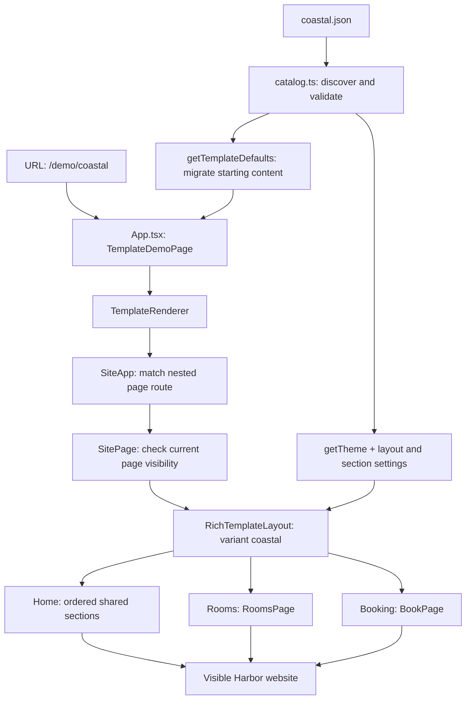
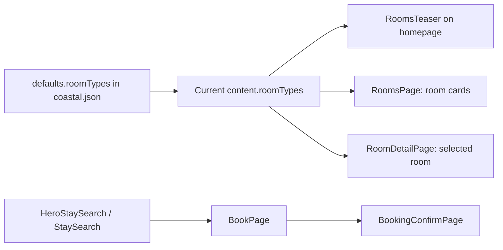
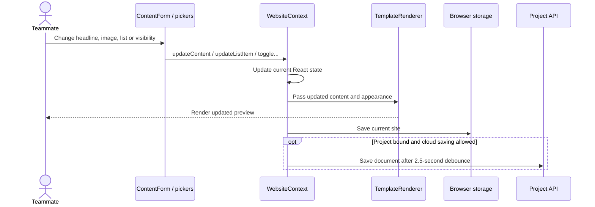
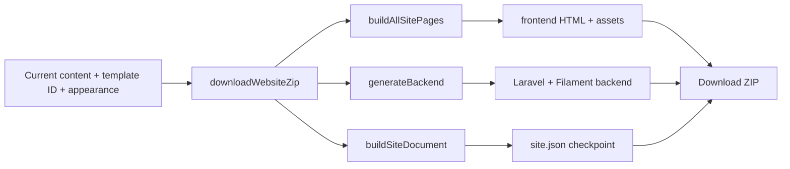

# Hotel template code guide — follow Harbor Resort

This guide traces the six hospitality templates from their JSON definitions to React pages, editor changes and downloaded sites. Harbor Resort (`coastal`) is the worked example. For other CMS templates, see [the CMS template guide](cms-template-guide.md).

## Find each hotel's source

| Gallery name | Template ID | Definition and starting content | Demo path |
|---|---|---|---|
| Harbor Resort | `coastal` | [coastal.json](../src/catalog/manifests/coastal.json) | `/demo/coastal` |
| Skyline Hotel | `hotel` | [hotel.json](../src/catalog/manifests/hotel.json) | `/demo/hotel` |
| Highland Hotel | `alpine` | [alpine.json](../src/catalog/manifests/alpine.json) | `/demo/alpine` |
| Courtyard Hotel | `ryokan` | [ryokan.json](../src/catalog/manifests/ryokan.json) | `/demo/ryokan` |
| Canopy Hotel | `jungle` | [jungle.json](../src/catalog/manifests/jungle.json) | `/demo/jungle` |
| Garden Guest House | `guesthouse` | [guesthouse.json](../src/catalog/manifests/guesthouse.json) | `/demo/guesthouse` |

Each definition supplies its own content and styling to shared React components. There is no standalone complete React app per hotel. Hospitality classification uses the manifest's `features` containing `hospitality`; see [hospitality.ts](../src/data/hospitality.ts).

Hospitality access is guarded by [useHospitalityTemplateGuard.ts](../src/hooks/useHospitalityTemplateGuard.ts). Allowed account roles are `SALESPERSON`, `AGENCY_ADMIN` and `PLATFORM_ADMIN`; see [hospitalityAccess.ts](../src/data/hospitalityAccess.ts).

## Harbor's complete render flow



### 1. Read Harbor's manifest

Open [coastal.json](../src/catalog/manifests/coastal.json). These keys answer different questions:

| Field | Harbor example | Meaning |
|---|---|---|
| `id` / `name` | `coastal` / Harbor Resort | URL/code identity and gallery label |
| `features` | `cms`, `hospitality` | Capabilities used by hospitality checks |
| `pages` | Rooms enabled, news disabled | Template-level page defaults/configuration |
| `homeSections` | `nav`, `hero`, `rooms-teaser`, … | Starting order of homepage sections |
| `theme` | `page: bg-sky-50 text-slate-800` | CSS classes passed to rendering components |
| `colorSchemes` | Aegean Blue, Santorini White, Coastal Sunset | Named palette options and theme overrides |
| `defaultLayoutVariantId` | `classic` | Starting presentation preset |
| `sectionVariants` | `contactShell: coastal-wave` | Choice of implemented section designs |
| `pageLayouts`, `hero` | Page/hero configuration | Settings consumed by shared renderers |
| `defaults` | Harbor copy, images, room types, visibility | Starting editable site content |

`defaults.pageVisibility` is part of the content passed to rendering and can be changed by the editor. Runtime page access checks current content through `canLinkToPage()`, rather than creating routes dynamically from the top-level `pages` object.

### 2. The demo loads starting content

[TemplateDemoPage.tsx](../src/pages/TemplateDemoPage.tsx) reads `templateId` from the URL, validates it, applies the hospitality guard and calls `getTemplateDefaults(id)`. It then passes the resulting content into:

```tsx
<TemplateRenderer templateId={id} content={content} basePath={`/demo/${id}`} />
```

For Harbor, `id` is `coastal` and `basePath` is `/demo/coastal`. The base path keeps links inside the selected template: its rooms link becomes `/demo/coastal/rooms`.

### 3. Routing selects a page

[TemplateRenderer.tsx](../src/templates/TemplateRenderer.tsx) forwards props to [SiteApp.tsx](../src/templates/SiteApp.tsx). `SiteApp` defines shared routes; `SitePage` checks visibility and sends a page name plus template ID to `RichTemplateLayout`.

| URL | Page value | Layout section selection |
|---|---|---|
| `/demo/coastal` | `home` | Harbor's `homeSections`, plus optional sections inserted by code |
| `/demo/coastal/about` | `about` | Navigation, about, team, testimonials, footer |
| `/demo/coastal/rooms` | `rooms` | Navigation, rooms page, footer |
| `/demo/coastal/rooms/<slug>` | `room-detail` | Navigation, room detail, footer |
| `/demo/coastal/book` | `book` | Navigation, booking page, footer |
| `/demo/coastal/book/confirm/<code>` | `booking-confirm` | Navigation, confirmation, footer |

Disabled/ineligible pages redirect to the base path. Hospitality templates omit the portfolio route.

### 4. The layout assembles React sections

In [RichTemplateLayout.tsx](../src/templates/RichTemplateLayout.tsx), `variant` is the template ID, `content: c` renames content to `c`, and `t = getTheme(...)` holds the resolved theme classes.

```text
variant = coastal       Which template?
page    = home          Which page?
c       = site content  What text, images, rooms and visibility?
t       = theme         Which CSS classes?
```

The homepage uses `homeSectionsFor(variant)`; other pages use the `PAGE_SECTIONS` map. The layout builds a `sections` map from names to React elements, then uses `order.map(...)` to render them. Null sections are skipped and per-block design settings wrap the rendered nodes.

The actual homepage order can differ from the raw JSON: `homeSectionsFor()` inserts `steps`, `pricing`, `team` and `cta` if absent. Their visibility flags decide whether they appear. A `news-teaser` entry also produces no section when current content has news disabled.

### 5. Watch JSON become a visible heading

Harbor's manifest contains these actual values, abbreviated here:

```json
{
  "theme": {
    "heroTitle": "text-5xl cmd:text-7xl font-light tracking-tight leading-none"
  },
  "defaults": {
    "businessName": "Harbor Resort",
    "tagline": "On the water, in the harbor"
  }
}
```

`HeroSection`, defined inside `RichTemplateLayout.tsx`, combines them:

```tsx
<h1 data-part="title" className={`mb-6 ${t.heroTitle}`}>{c.tagline}</h1>
```

The text comes from `c.tagline`; its appearance comes from `t.heroTitle`. The same component renders `HeroStaySearch` for hospitality templates. To edit the initial heading, change `defaults.tagline`; to edit only a customer's heading, use the editor; to change the heading's HTML structure, edit `HeroSection` and review the export renderer.

## Rooms and booking: where the hotel-specific UI lives



| Task | Source to inspect |
|---|---|
| Change initial room names, descriptions, prices or photos | `defaults.roomTypes` in [coastal.json](../src/catalog/manifests/coastal.json) |
| Edit room content through the builder | [ContentForm.tsx](../src/components/ContentForm.tsx); search `roomTypes` |
| Change homepage room cards | `RoomsTeaser` in [RichTemplateLayout.tsx](../src/templates/RichTemplateLayout.tsx) |
| Change room listing/detail/booking markup | `RoomsPage`, `RoomDetailPage`, `BookPage`, `BookingConfirmPage` in [BookingPages.tsx](../src/templates/booking/BookingPages.tsx) |
| Change booking search markup | `HeroStaySearch` / `StaySearch` in the same file |
| Hotel-specific visual styling | [hospitalitySkin.ts](../src/templates/booking/hospitalitySkin.ts) |
| Room normalization and sample booking behavior | [hospitality.ts](../src/data/hospitality.ts), [bookingPreview.ts](../src/data/bookingPreview.ts) |
| Generated booking backend | `src/export/backend/`; inspect `generateBooking.ts` and `generateCrsBooking.ts` |

Builder booking previews and a deployed booking backend run in different environments. For booking changes, inspect preview helpers as well as the selected generated backend integration before explaining availability or confirmation behavior.

## Codebase map

Paths in this guide are relative to `web-builder-exp/`; links open the source files. The sibling `buildoura-api/` and `buildoura-admin/` directories are separate applications.

```text
web-builder-exp/
├── src/
│   ├── App.tsx                       Application routes and providers
│   ├── pages/                        Gallery, demo, editor, preview, account screens
│   ├── catalog/
│   │   ├── manifests/<id>.json        Template definitions and starting content
│   │   ├── catalog.ts                Discover, validate and look up manifests
│   │   ├── types.ts                  Manifest field definitions
│   │   └── validate.ts               Manifest validation rules
│   ├── data/                         Defaults, navigation, editor profiles and presets
│   ├── components/                   Content forms, images and appearance controls
│   ├── context/WebsiteContext.tsx    Current site state and persistence
│   ├── templates/                    React pages and shared rendering components
│   ├── siteDocument/                 Saved site document schema, validation and I/O
│   ├── export/                       Static HTML and generated Laravel backend
│   ├── api/                          Builder API clients, including project drafts
│   ├── auth/                         Login state and protected routes
│   ├── types/                        SiteContent and related TypeScript types
│   ├── assets/hero-sections/          Gallery thumbnails, named <id>.png
│   └── utils/                        Storage, migrations, links and image helpers
├── public/                           Public assets and Apache SPA routing rules
└── docs/                             These navigation guides
```

## Three kinds of data to keep separate

| Layer | Example | When you change it |
|---|---|---|
| Template definition | `theme`, `homeSections`, `pageLayouts`, `defaults` in a manifest | Change the starting design/content offered by the builder |
| Current site content | `WebsiteContext.content`, with text, lists and visibility | Edit one customer's site in the builder |
| Saved/exported site | Project document, `site.json`, generated HTML and Laravel files | Restore a project or deploy its generated website |

The catalog loader in [catalog.ts](../src/catalog/catalog.ts) uses `import.meta.glob('./manifests/*.json', { eager: true })`. It validates bundled manifests and indexes them by `id`. Invalid bundled manifests produce an error. Imported manifests can also be stored in the browser and override a bundled ID; inspect imported templates if the browser differs from the source JSON.

[defaults.ts](../src/data/defaults.ts) loads `manifest.defaults` through `migrateContent()`. This fills/normalizes content for the current schema. A manifest is therefore the starting point, while rendered content may also reflect migration, selected branding or an existing saved project.

## How editing a site's content works



[ContentForm.tsx](../src/components/ContentForm.tsx) reads `useWebsite()` and calls actions provided by [WebsiteContext.tsx](../src/context/WebsiteContext.tsx). For example, the business-name control uses this pattern:

```tsx
onChange={(v) => updateContent({ businessName: v })}
```

`updateContent` merges the supplied fields into existing content:

```tsx
setContent((prev) => ({ ...prev, ...updates }))
```

| Kind of edit | Action / source |
|---|---|
| Headline, business name, contact details | `updateContent({ field: value })` |
| An existing list item | `updateListItem(list, index, field, value)` |
| Add/remove a list item | `addListItem(list)` / `removeListItem(list)`; see `data/listDefaults.ts` |
| Enable/disable a page | `togglePageVisibility(page)` |
| Enable/disable an optional section | `toggleSectionVisibility(section)` |
| Color scheme or layout preset | `setColorScheme()` / `setLayoutVariant()` |
| Restore an imported or saved document | `restoreSite()` / `bindProject()` |

These actions edit the current site in memory and persistence; they do not rewrite a source manifest. Local saving uses [storage.ts](../src/utils/storage.ts). Cloud saving requires a bound project and `canCloudSave`; `persistNow()` performs an explicit project save. Project data can replace defaults when opening an existing project.

### Edit starting content as a developer

1. Open `src/catalog/manifests/<id>.json`.
2. Change fields under `defaults` for initial copy, images or list data.
3. Use `/demo/<id>` to check the starting content directly.
4. Use the editor to check controls and the current project. A saved draft can still contain the previous text; a source-default change does not rewrite customer projects.

### Edit appearance or add a field

| Desired change | Start here | Also inspect |
|---|---|---|
| Default theme classes | Manifest `theme` | `templates/getTheme.ts`, selected color scheme overrides |
| Color choices | Manifest `colorSchemes` | `data/colorSchemes.ts`, branding fields and `templates/customPaletteTheme.ts` |
| Layout preset | `data/layoutVariants.ts` | `templates/templateShells.css` and relevant section markup |
| Which controls the editor offers | Manifest `editorPages` / `editorSections` | `data/editorProfile.ts`, visibility pickers |
| A new content field | `src/types/`, manifest defaults | `ContentForm.tsx`, migration, preview and export consumers |
| Different HTML structure | React component rendering that section | Matching static/Blade export implementation |

For a new field, trace it all the way through: type → default/migration → editor control → current state → React output → generated output. Existing JSON layout tokens only select engines already implemented by the app; adding an arbitrary token does not create a renderer.

## Download flow: another rendering path



[downloadZip.ts](../src/export/downloadZip.ts) packages static pages from [buildSitePages.ts](../src/export/buildSitePages.ts), backend source from [generateBackend.ts](../src/export/backend/generateBackend.ts), and a restorable `site.json` document. React preview markup and exported HTML are implemented separately. A React change does not automatically update generated HTML.

The exported Laravel/Filament admin is the deployed site's CMS. Its generated source lives under `src/export/backend/` in the builder; `backend/` is created inside the downloaded ZIP. Changes made in that deployed CMS do not automatically rewrite the builder's manifests or an already downloaded static frontend.

## Run and verify locally

From the workspace root:

```bash
cd web-builder-exp
npm ci
npm run dev
```

Use the Vite address printed in the terminal. `/templates` opens the gallery; `/demo/<id>` shows starting content; `/editor/<id>` edits a site; `/preview/<id>` previews it. Editor and preview routes require login. The editor also respects project editing/export entitlements.

After a code change, run the relevant checks:

```bash
npm run lint
npm run build
```

Then inspect the changed page in the browser. If markup or generation changed, download a site and inspect the corresponding generated page too.

## When a change does not appear

| Symptom | What to inspect |
|---|---|
| JSON text changed but editor still shows old text | Current project/local draft; compare against `/demo/<id>` |
| Theme edit appears to be ignored | Selected scheme overrides, brand colors, custom palette and block styles |
| Section is listed but invisible | `sectionVisibility`, `pageVisibility`, conditional rendering and block hide settings |
| Page redirects to the template homepage | `SiteApp` route guard and `data/siteNav.ts` page eligibility |
| Preview is correct but download differs | The matching generator under `src/export/` |
| Browser template differs from bundled JSON | Imported catalog manifests persisted in browser storage |

## Explain Harbor to a teammate

> Harbor is the `coastal` manifest plus shared hotel components. The URL selects a page, the current content supplies text and rooms, and the layout combines those values with Harbor’s styling. Editor changes update current site state; export generators turn that state into deployable files.
